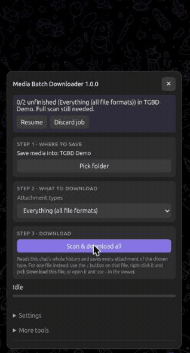
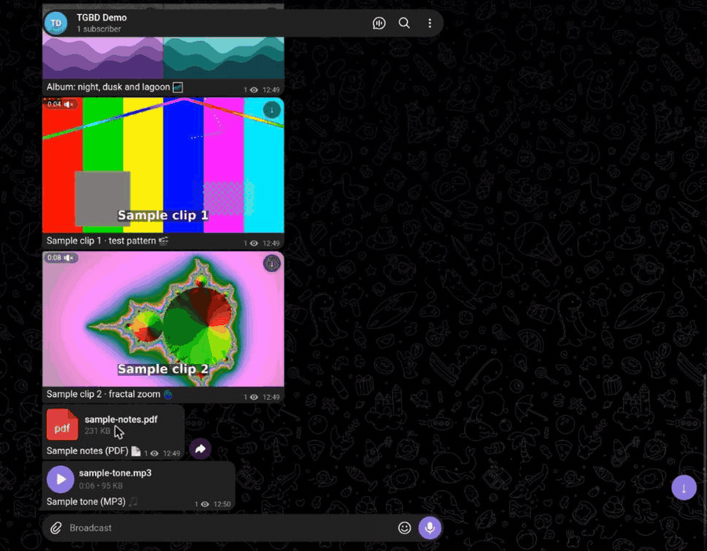

# Telegram Media Batch Downloader

[](https://github.com/Alfa-Dev404/telegram-batch-downloader/actions/workflows/ci.yml)
[](https://github.com/Alfa-Dev404/telegram-batch-downloader/actions/workflows/codeql.yml)
[](LICENSE)
[](https://greasyfork.org/en/scripts/605258-telegram-media-batch-downloader)

A userscript for [Telegram Web K](https://web.telegram.org/k/) that saves a chat's attachments straight into a folder on your computer: one file, a selection, or the whole history. It checks every file against the exact size Telegram reports, writes the captions next to the files, and picks up where it left off if you close the tab.

No Telegram API keys, no bot, no install beyond the script. It runs inside your own logged-in Telegram tab.

Based on [Telegram Web - Media Batch Downloader](https://greasyfork.org/en/scripts/567432-telegram-web-media-batch-downloader) by **OsoCosmico**.


<sub>All demos are recorded in Telegram Web K on a private test channel, using sample media made for this project.</sub>

> **For educational purposes only.** This is a learning project about how Telegram Web works. Only download content you have the right to keep, and respect the people who share it. You are responsible for how you use it.

## Features

-   **Whole-chat download.** Reads the full history and saves every attachment of the type you pick: videos, audio, voice messages, photos, GIFs, stickers or any other file.
-   **Writes into a folder.** Files go directly into the folder you choose, without passing through browser downloads.
-   **Exact size check.** A file only counts as done when its size on disk matches Telegram's to the byte. "Check saved files" re-checks the whole folder at any time.
-   **Resumable.** Cancel, close the tab or lose your connection, then press Resume. Finished files are kept, and an interrupted scan continues from where it stopped.
-   **Captions.** Every file gets a `.txt` with its date, message link, sender and caption, plus a `_captions.json` index for the whole chat.
-   **Single files too.** Use the ↓ on any attachment, the right-click menu, or the media viewer. Without a folder, the file goes to your normal downloads.
-   **Settings panel.** Speed presets (Safe, Balanced, Fast) and individual limits. Every value is checked before it's saved, so a typo can't break a job.
-   **Matches Telegram's theme.** Day, night and tinted.
-   **Reports.** Export an HTML report or the full file list as JSON.

## Install

1. Install [Tampermonkey](https://www.tampermonkey.net/) (or Violentmonkey).
2. Install the script from **[Greasy Fork](https://greasyfork.org/en/scripts/605258-telegram-media-batch-downloader)**, or straight from this repo: **[telegram-batch-downloader.user.js](https://raw.githubusercontent.com/Alfa-Dev404/telegram-batch-downloader/main/telegram-batch-downloader.user.js)**. Both stay up to date automatically.
3. Open [web.telegram.org/k](https://web.telegram.org/k/). A round ↓ button appears at the bottom right.

Saving into a folder needs a desktop browser with the File System Access API: **Chrome, Edge, Brave or Opera**. Firefox and mobile browsers can still save single files (up to 512 MB by default) through normal downloads.

## Usage

**Whole chat**

1. Open the chat and click the round ↓ button.
2. **Pick folder.** Use a separate folder for each chat.
3. Choose the attachment types.
4. **Scan & download all.**



**One file:** hover over an attachment and click its ↓ (shown at the top), or right-click it and choose **Download this file**.



**A few messages:** select them with Telegram's own Select, then click **Download selected messages**.

**Picking up later:** reopen the chat and press **Resume** in the panel. Files already on disk with the right size are skipped.

## Settings


| Setting                       | Default | What it does                                             |
| ----------------------------- | ------- | -------------------------------------------------------- |
| Files at once                 | 3       | How many files download in parallel (1–5)                |
| Parallel requests             | 4       | Chunk requests in flight for the whole job (1–8)         |
| Pause between files           | 200 ms  | Gap before starting the next file                        |
| Attempts per request          | 3       | Retries for real errors; rate-limit waits don't count    |
| Longest rate-limit wait       | 30 min  | How long one request may be told to wait before it fails |
| Request timeout               | 120 s   | Stops the job if Telegram stops answering                |
| Biggest file without a folder | 512 MB  | Memory limit for browser-download mode                   |

**Safe** (1 file, 2 requests) is gentler on busy accounts. **Fast** (5 files, 8 requests) is quicker but triggers more of Telegram's rate-limit pauses. Settings are locked while a job runs.

## Good to know

-   **Web K only.** On Web A (`/a/`) you'll be offered a switch to Web K.
-   **Rate limits.** Telegram sometimes asks clients to slow down (FLOOD_WAIT). The script waits it out and shows a countdown. Heavy bulk downloading on one account is still your own risk.
-   **It relies on Telegram Web internals.** A Telegram update can break it until the script is updated. Please open an issue if that happens.
-   **Size check, not checksum.** "Complete" means the byte count matches Telegram's. It doesn't hash the content.

## Privacy

-   The script only talks to Telegram, through your own open session. It loads no remote code and sends nothing anywhere else.
-   Job progress lives in your browser's storage for web.telegram.org, and settings in Tampermonkey's storage.
-   **Copy debug info** is safe to paste into a public issue: it leaves out your account ID, chat names, file names and captions. **Copy job JSON** does include them, so keep that one private.

## Development

No dependencies and no build step. With Node 22 or newer:

```
node --test                      # logic, download engine and security tests
npx prettier@3.3.3 --write .     # formatting
```

-   `test/download.test.js` runs the real download engine against a fake Telegram API and an in-memory folder: parallel chunks, expired file references, rate limits, cancel, account switches and name clashes.
-   `test/security.test.js` feeds in hostile file names and HTML, checks the debug info stays anonymous, and fails if the script gains new permissions, network calls, dynamic code or `innerHTML` built from data.

Planned features are listed in [ROADMAP.md](ROADMAP.md).

Every push and pull request runs the tests, a formatting check and [CodeQL](https://codeql.github.com/), and pull requests get a [CodeRabbit](https://coderabbit.ai/) review. See [CONTRIBUTING.md](CONTRIBUTING.md), and report security problems privately as described in [SECURITY.md](SECURITY.md).

## Credits

This project started from [Telegram Web - Media Batch Downloader](https://greasyfork.org/en/scripts/567432-telegram-web-media-batch-downloader) by **OsoCosmico**, released under the MIT license. Thanks for the original idea and code. Version 1.0 is a full rewrite by **Alfa-Dev404**; the original copyright notice is kept in [LICENSE](LICENSE).

## License

[MIT](LICENSE)
